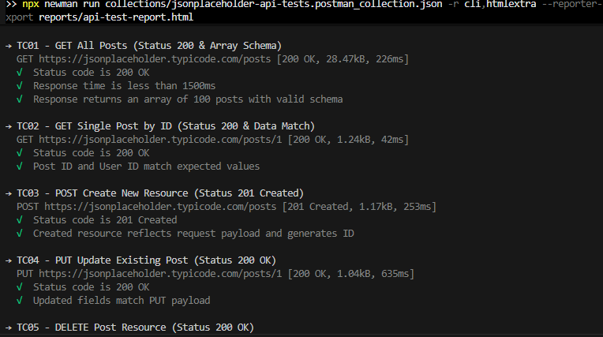
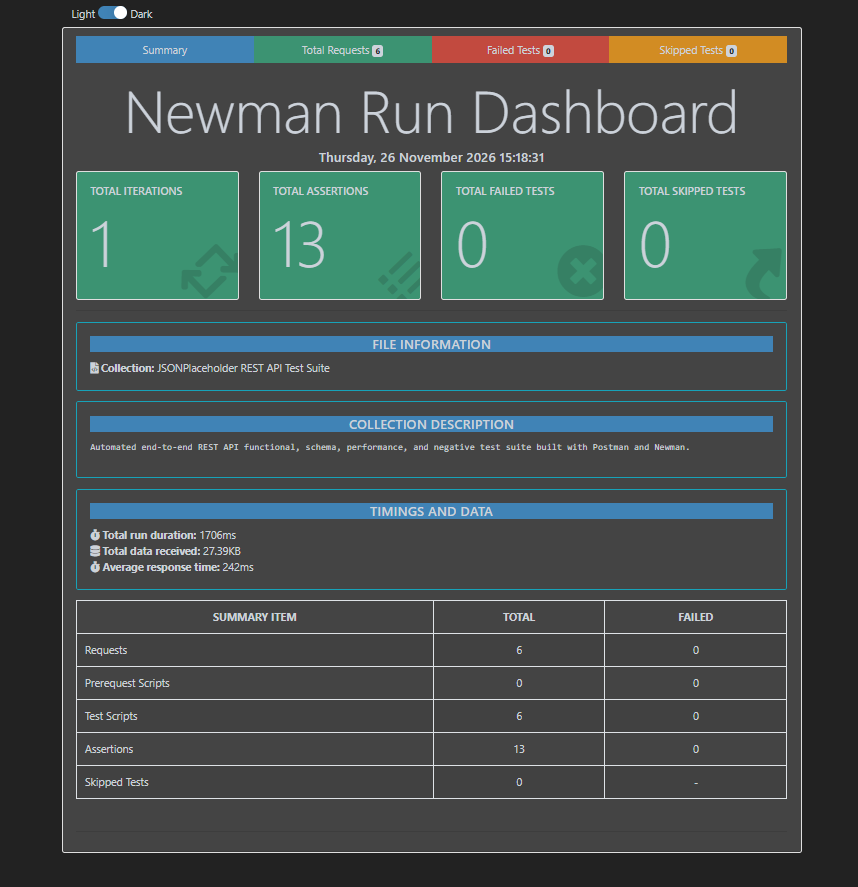

# 🚀 Automated REST API Test Suite (Postman & Newman)

[](https://www.postman.com/)
[](https://github.com/postmanlabs/newman)
[](https://nodejs.org/)

An automated RESTful API testing suite built with **Postman** and executed via **Newman CLI** (`newman-reporter-htmlextra`) against the [JSONPlaceholder REST API](https://jsonplaceholder.typicode.com/). This suite validates full CRUD workflows (`GET`, `POST`, `PUT`, `DELETE`), response payload/schema integrity, response time thresholds, and negative error handling (`404 Not Found`).

---

## 📋 Table of Contents
- [Overview & Tech Stack](#-overview--tech-stack)
- [Project Structure](#-project-structure)
- [Automated API Test Cases](#-automated-api-test-cases)
- [Setup & Execution](#-setup--execution)
- [Test Execution Evidence](#-test-execution-evidence)

---

## 🛠️ Overview & Tech Stack

* **API Design & Collection:** Postman Collection Format v2.1 (`collections/jsonplaceholder-api-tests.postman_collection.json`)
* **Automated Test Runner:** Newman CLI (`newman`)
* **Assertion Library:** Postman Sandbox / Chai assertions (`pm.test`, `pm.response.to.have.status`, `pm.expect`)
* **HTML Reporting:** `newman-reporter-htmlextra` interactive HTML test dashboard
* **Runtime:** Node.js (`npm`)

---

## 📂 Project Structure

```text
api-testing-postman-newman/
├── collections/
│   └── jsonplaceholder-api-tests.postman_collection.json  # Postman API collection & test scripts
├── reports/
│   └── api-test-report.html                               # Generated Newman HTML test report
├── screenshots/
│   ├── newman-cli-report.png                              # CLI execution & assertion summary
│   └── postman-html-dashboard.png                         # HTML report dashboard evidence
├── .gitignore                                             # Ignores node_modules
├── package.json                                           # Dependencies & npm test scripts
├── package-lock.json                                      # Locked dependency versions
└── README.md                                              # Project documentation
```

---

## 🧪 Automated API Test Cases

| Test ID | Request & Endpoint | Test Category | Key Assertions Validated | Result |
| :--- | :--- | :--- | :--- | :--- |
| **TC01** | `GET /posts` | Functional / Schema / Performance | Status `200 OK`, response time `< 1500ms`, array of `100` items with exact keys (`userId`, `id`, `title`, `body`) | ✅ Pass |
| **TC02** | `GET /posts/1` | Functional / Data Integrity | Status `200 OK`, `id === 1`, `userId === 1`, non-empty `title` string | ✅ Pass |
| **TC03** | `POST /posts` | CRUD Create / Payload | Status `201 Created`, response echoes request `title`, `body`, `userId`, and assigns numeric `id` | ✅ Pass |
| **TC04** | `PUT /posts/1` | CRUD Update | Status `200 OK`, updated `title` and `id` match request payload | ✅ Pass |
| **TC05** | `DELETE /posts/1` | CRUD Delete | Status `200 OK`, response body is an empty JSON object `{}` | ✅ Pass |
| **TC06** | `GET /posts/99999` | Negative Testing | Status `404 Not Found` for invalid/non-existent resource ID, empty object `{}` body | ✅ Pass |

---

## ⚙️ Setup & Execution

### 1. Install Dependencies
```bash
npm install
```

### 2. Run API Test Suite & Generate HTML Report
```bash
npx newman run collections/jsonplaceholder-api-tests.postman_collection.json -r cli,htmlextra --reporter-htmlextra-export reports/api-test-report.html
```

---

## 📊 Test Execution Evidence

### 1. Newman CLI Execution Summary (13/13 Assertions Passed)


### 2. HTML Test Report Dashboard


---

## 👤 Author

**Samitha Tharanga Wijesinghe**  
B.Sc. (Hons) in Information Technology Undergraduate | Aspiring QA & Test Automation Engineer  
- **GitHub:** [@samithatharanga](https://github.com/samithatharanga)
